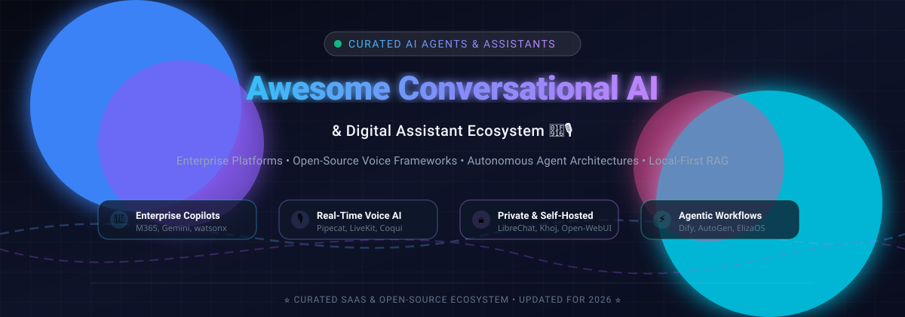

# Awesome Conversational AI & Digital Assistant Ecosystem 🤖🎙️

  

  
  
  
  
  
  
  

> **A curated, comprehensive guide to state-of-the-art Conversational AI platforms, enterprise digital assistants, real-time voice agents, and self-hosted open-source second brain architectures.**  
> *Last updated: March 2026*

---

## 🧭 Table of Contents
- [📌 Sector Overview & Market Dynamics](#-sector-overview--market-dynamics)
- [🏢 SaaS & Enterprise Hosted Platforms](#-saas--enterprise-hosted-platforms)
- [💻 Open-Source GitHub Projects](#-open-source-github-projects)
- [🛠️ Architecture & Integration Guide](#️-architecture--integration-guide)
- [🤝 How to Contribute](#-how-to-contribute)
- [💖 Support](#-support)
- [📊 Star History](#-star-history)
- [📜 Disclaimer](#-disclaimer)

---

## 📌 Sector Overview & Market Dynamics

The global **conversational AI and digital assistant** market is estimated at **~$17.7B to $19.7B in 2026**, on track to surpass **$40B+ by 2030** (expanding at an estimated **~22–24% CAGR**). 

The industry demonstrates a compelling dual market structure:
- **Foundational Layer (Concentrated):** The underlying foundation models, multi-modal LLM weights, speech foundation networks, and enterprise cloud infrastructure remain heavily concentrated among top hyperscalers and frontier labs (Microsoft, Google, OpenAI, IBM).
- **Application & Orchestration Layer (Moderately to Highly Fragmented):** Specialized enterprise workflow copilots, real-time voice orchestration runtimes, contact center automation bots, and local-first privacy agents are actively distributed across numerous nimble SaaS providers and rapidly innovating open-source communities.

---

## 🏢 SaaS & Enterprise Hosted Platforms

Curated leading commercial SaaS and managed platforms offering turn-key enterprise conversational AI, copilot suites, and omnichannel digital agents. Sorted by company scale (valuation / market capitalization descending):

| Product | Scale (Valuation / Revenue) | Description | Starting Pricing | Free Tier / Free Trial Limits |
|---|---|---|---|---|
| **[Microsoft Copilot](https://www.microsoft.com/en-us/microsoft-copilot)** | ~$3.9T Market Cap (Microsoft) | Enterprise AI assistant integrated across Microsoft 365 (Word, Excel, Teams, Outlook) and Windows. Grounded in organizational data via Microsoft Graph. | **$30/user/month** (annual commitment, Microsoft 365 Copilot add-on) | **30-day free trial** (up to 25 seats for qualifying Microsoft 365 business accounts; no upfront card required) |
| **[Google Gemini Enterprise](https://cloud.google.com/gemini)** | ~$3.6T Market Cap (Alphabet) | Enterprise AI assistant integrated with Google Workspace and Google Cloud. Grounded in organizational data, with Vertex AI model garden access. | **$21/user/month** (annual commitment, Gemini Enterprise / Business add-on) | **30-day free trial** for Google Workspace enterprise add-ons (or 14-day trial for core Google Workspace accounts up to 10 users) |
| **[OpenAI ChatGPT Enterprise](https://openai.com/enterprise)** | ~$1.25T Valuation / ~$50B ARR (OpenAI) | Enterprise-grade ChatGPT with advanced security, admin controls, unlimited high-speed GPT access, and data analysis. Does not train on business data. | **$20/user/month** (ChatGPT Business/Team billed annually; custom enterprise contracts typically start at $45–$75/user/month, min. 150 seats) | **No free trial for Enterprise/Team plans** (Consumer ChatGPT free tier available with standard rate limits) |
| **[IBM watsonx Assistant](https://www.ibm.com/products/watsonx-assistant)** | ~$232B Market Cap (IBM) | Enterprise conversational AI platform for building AI assistants across channels. Enterprise adds data isolation and HIPAA support. | **$140/month** (Plus plan, includes 1,000 MAUs; additional MAUs at $14 per 100, voice at $9 per 100 MAUs) | **Free forever plan (Lite)**: Up to 1,000 unique MAUs/month and 10,000 messages/month (1 instance per account, deactivates after 30 days of inactivity) |
| **[Zoho Zia](https://www.zoho.com/zia/)** | ~$12B Valuation / ~$1.5B ARR (Zoho Corp) | AI assistant embedded across Zoho applications. Includes predictive analytics, Ask Zia, and Zia Agent Studio workflow automation within the Zoho ecosystem. | **$40/user/month** (Zoho CRM Enterprise billed annually, required for native Zia features; Zia Agent Studio platform is free) | **15-day free trial** with full access to Enterprise features (no credit card required; Zia Agent Studio includes up to 30M free LLM tokens/month) |
| **[Amelia](https://amelia.ai/)** | ~$1.8B Market Cap (SoundHound AI; acquired Amelia for $80M) | Enterprise AI assistant (formerly IPsoft, now part of SoundHound AI) delivering autonomous agents for IT operations, customer service, and HR. | **$80,000/year** (Enterprise deployment contracts typically start at $80,000–$100,000+/year based on custom scoped volumes and integration requirements) | **No self-serve free trial** (Evaluation requires a guided enterprise sales engagement and customized pilot demo) |
| **[Kore.ai](https://kore.ai/)** | ~$1.2B Valuation / ~$100M+ ARR (Kore.ai) | Enterprise conversational AI platform for building, deploying, and managing AI assistants across voice and digital channels. | **$100 account reload** (Pay-as-you-go model after free allowance; custom enterprise quotes for annual volume contracts) | **Free forever tier**: 5,000 free conversation sessions per account (up to 5 bots); standard 30-day enterprise evaluation trial |

---

## 💻 Open-Source GitHub Projects

Curated top-tier open-source repositories for building conversational agents, real-time voice assistants, personal second brains, and autonomous multi-agent pipelines. **Sorted by GitHub_Stars_Count (descending)**:

| Project | Stars_Badge | Description |
|---|---|---|
| **[Dify](https://github.com/langgenius/dify)** |  | All-in-one LLM application development platform for building agentic workflows, multi-agent teams, and conversational assistants with integrated visual RAG orchestration. |
| **[Open WebUI](https://github.com/open-webui/open-webui)** |  | Self-hosted, extensible AI user interface and conversational assistant for local and remote models (Ollama, OpenAI, Gemini). Includes RAG, web browsing, voice, and multi-user RBAC. |
| **[AutoGen](https://github.com/microsoft/autogen)** |  | Microsoft framework for building conversational multi-agent systems where autonomous agents converse to solve complex multi-turn tasks. |
| **[LibreChat](https://github.com/LibreChat-AI/LibreChat)** |  | Enhanced open-source ChatGPT clone with multi-provider AI support, Model Context Protocol (MCP), code execution, web search, multimodal agents, and multi-user administration. |
| **[Coqui TTS](https://github.com/coqui-ai/TTS)** |  | Deep learning toolkit for Text-to-Speech (TTS) voice generation, powering lifelike natural spoken interfaces for local and production voice assistants. |
| **[OpenVoice](https://github.com/myshell-ai/OpenVoice)** |  | Instant voice cloning and audio foundation model supporting flexible control over tone, emotion, accent, and cadence for conversational voice bots. |
| **[Khoj](https://github.com/khoj-ai/khoj)** |  | Self-hostable personal AI assistant and second brain. Chats and searches across your local notes, PDFs, and documents with scheduled automations and deep research. |
| **[STORM](https://github.com/stanford-oval/storm)** |  | LLM-powered knowledge curation and conversational research assistant developed at Stanford that conducts deep topic research with grounded citations. |
| **[GPT Researcher](https://github.com/assafelovic/gpt-researcher)** |  | Autonomous conversational research assistant capable of conducting comprehensive online web investigations and synthesizing detailed analytical reports. |
| **[ElizaOS](https://github.com/elizaOS/eliza)** |  | Modular multi-agent conversational AI operating system for deploying autonomous agents across Discord, Twitter, and custom digital assistant interfaces. |
| **[Pipecat](https://github.com/pipecat-ai/pipecat)** |  | Framework for ultra-low latency real-time voice, video, and multimodal AI agents. Orchestrates STT, LLMs, and TTS with round-trip response under 800ms. |
| **[LiveKit Agents](https://github.com/livekit/agents)** |  | Real-time voice and multimodal AI agent framework built on WebRTC with turn detection, interruptions, and direct telephony support. |
| **[Herzen](https://github.com/pavel-arkharov/herzen)** |  | Local-first AI voice assistant runtime for private, on-device orchestration. TypeScript monorepo using whisper.cpp for local STT, Ollama for local LLM, and Silero VAD. |

---

## 🛠️ Architecture & Integration Guide

Building state-of-the-art conversational AI assistants typically requires connecting several modular building blocks:

1. **Audio Streaming & Voice Endpointing (Speech-to-Text):** Use **Pipecat** or **LiveKit Agents** paired with Silero VAD and Whisper/Deepgram for ultra-low-latency streaming audio pipelines.
2. **Conversation & Reasoning Core (LLMs & Agents):** Run local models via Ollama/vLLM or connect frontier LLM providers (Anthropic Claude, OpenAI GPT, Google Gemini) orchestrated by **Dify**, **AutoGen**, or **ElizaOS**.
3. **Knowledge Grounding & Retrieval (RAG):** Ground responses using your private documents and external search tools via **Khoj**, **Open WebUI**, or **STORM**.
4. **Natural Vocal Expression (Text-to-Speech):** Synthesize expressive human-like spoken audio with **Coqui TTS**, **OpenVoice**, Cartesia, or ElevenLabs.
5. **Full Privacy & Self-Hosting:** Deploy **LibreChat** or **Open WebUI** behind enterprise SSO/OAuth to maintain complete data sovereignty without recurring per-seat SaaS licensing.

---

## 🤝 How to Contribute

Contributions, project submissions, and suggestions are warmly welcomed!

1. 🍴 **Fork** the repository.
2. 🌿 **Create a branch** for your addition: `git checkout -b feature/add-new-assistant`.
3. 📝 **Add or edit entries** in `README.md` keeping formatting clean, descriptions objective, and links accurate.
4. 🚀 **Commit & Push** your changes: `git commit -m "Add New Assistant"` and `git push origin feature/add-new-assistant`.
5. 📬 **Open a Pull Request** explaining why the project or platform is a great addition to the ecosystem.

---

## 💖 Support

If you find this curated collection of Conversational AI & Digital Assistant tools valuable:
- ⭐ **Star this repository** to keep up with the latest updates!
- 🍴 **Fork and share** with colleagues, AI developers, and engineering teams.
- ☕ **Support the maintainer**: If this list saved you time or helped your project, consider buying a coffee or becoming a sponsor at the **[GitHub Sponsors Dashboard](https://github.com/sponsors/ishandutta2007)**!

---

## 📊 Star History

---

## 📜 Disclaimer

- This repository is a **community-curated index** intended for educational, research, and technical evaluation purposes. Inclusion does not imply official endorsement.
- Conversational AI and digital assistants often ingest confidential enterprise communications and sensitive user knowledge; always verify data residency, telemetry practices, and regulatory compliance before deploying in production environments.
- Listed pricing, tiers, and subscription conditions reflect public information available as of early 2026 and are subject to change by respective vendors.

---

  Maintained with ❤️ by <a href="https://github.com/ishandutta2007">Ishan Dutta</a> and the global AI open-source community.

